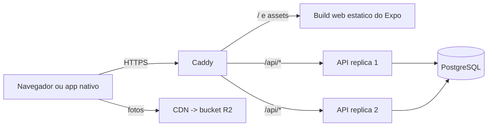

# ADR 0001 · Origem única: o Caddy serve o web e faz proxy de /api

Status: aceito · 01/11/2026

## Contexto

O cliente Expo exportado como web estático é o acesso principal da fase 1: na
avaliação remota, cada avaliador abre o aplicativo no navegador, pela própria conexão. A API é
ASP.NET Core, e na web o refresh token vive em cookie `HttpOnly` emitido pela API. Duas
topologias eram possíveis, e a escolha determina CORS, cookie e CSP de uma vez.

## Opções

| Opção | Peso |
|---|---|
| **Origem única**: Caddy serve `/` com o build web e faz proxy de `/api/*` para a API | **9** |
| API em subdomínio (`api.maxx…`), web em outro host | 5 |

## Decisão

Origem única. O nativo aponta para a mesma URL pública, com o prefixo `/api`.

## Consequências

- Nenhum CORS e nenhum preflight em mutação: um salto de rede menos em cada escrita.
- O cookie de refresh é first-party, com `SameSite=Strict` viável.
- Um certificado, um domínio, uma CSP.
- **Negativa:** web e API ficam acoplados no mesmo host e no mesmo Caddy. Escalar um sem
  o outro exige mudar a topologia, e a API não pode trocar de domínio sem atualizar o
  binário nativo já distribuído.
- **Negativa:** o espaço de rotas é compartilhado. `/api` fica reservado, e o deep link
  `/post/:id` precisa ser servido pelo build web, não pela API: qualquer rota nova de
  API entra sob o prefixo, sem exceção.
