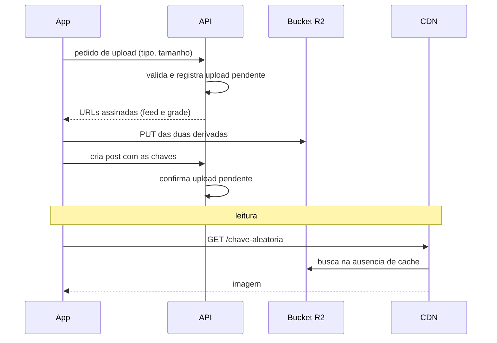

# ADR 0002 · Fotos nunca passam pela API, e a leitura é pública por chave aleatória

Status: aceito · 01/11/2026

## Contexto

Posts e perfis têm foto, e o pico previsto é de 2.000 usuários simultâneos em dia de
evento, justamente quando muita gente reivindica prêmio com foto. Imagem é o maior
volume de bytes do sistema, e o orçamento da fase 1 é mínimo. Duas perguntas separadas:
por onde sobe, e quem pode ler.

## Opções

Subida:

| Opção | Peso |
|---|---|
| **API assina URL e o app envia direto ao bucket** | **9** |
| App envia para a API, que repassa ao bucket | 3 |

Leitura:

| Opção | Peso |
|---|---|
| **Chave aleatória e leitura pública pela CDN** | **8** |
| URL assinada de curta duração a cada leitura | 5 |
| Cookie assinado de CDN | 4 |

## Decisão

A API nunca recebe bytes de imagem. Ela valida tipo e tamanho e devolve uma URL de
upload assinada, com o `content-type` preso na assinatura. O app envia direto para o
bucket privado no Cloudflare R2. A leitura é pela CDN, com chave aleatória (ULID), e é
**pública para quem tem o link**.

## Consequências

- A API fica fora do caminho dos bytes: o pico de upload não consome CPU nem banda dela.
- Cache da CDN em sua eficiência máxima, com egresso zero no R2.
- **Negativa:** a foto é acessível a qualquer um que tenha a URL, mesmo sem conta. A
  mitigação é a chave aleatória, que torna a URL não descobrível, e o termo de uso, que
  informa isso ao aluno. É a decisão de privacidade mais exposta do projeto, e está
  registrada como tal em `docs/produto.md`, seção 12.
- **Negativa:** upload abandonado precisa de limpeza própria (tabela de uploads pendentes
  e trabalho na fila), porque a API não sabe sozinha o que chegou ao bucket.
- **Negativa:** a API não pode inspecionar a imagem antes de publicar. Moderação é
  reativa: a instituição remove o post depois.
