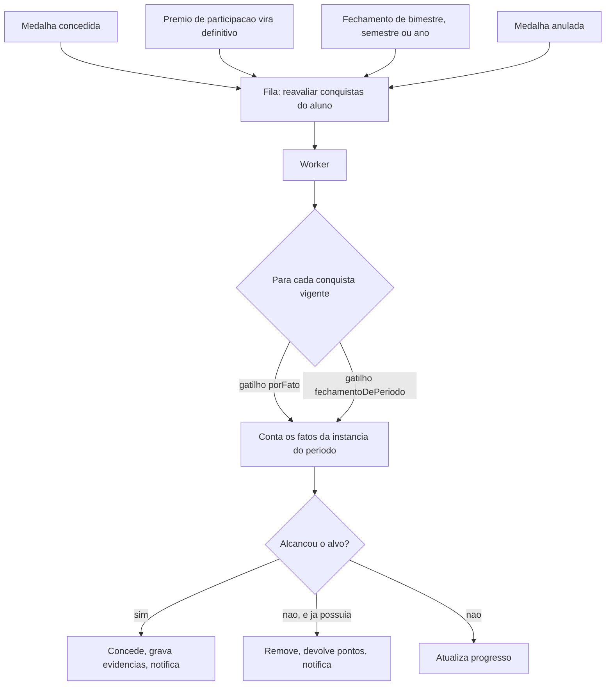

# ADR 0004 · Conquista é dado declarativo, avaliado por um motor único

Status: aceito · 01/11/2026

## Contexto

São 18 conquistas na fase 1, e elas são regra de produto: a instituição vai querer mexer
em alvo, período e valor sem esperar deploy. Analisando as 18, elas se reduzem a duas
formas de contagem sobre o mesmo conjunto de fatos (medalhas e prêmios de participação
definitivos) dentro de uma instância de período.

## Opções

| Opção | Peso |
|---|---|
| **Especificação declarativa no catálogo + um avaliador**, com escape para regra em C# | **9** |
| Uma classe C# por conquista (18 classes) | 7 |
| Uma consulta SQL por regra | 3 |

## Decisão

A regra vive em `data/catalogo/conquistas.json`, em duas formas (`contagem` e
`contagemDistinta`), e um avaliador único as executa. O escape para C# está documentado e
**sem uso**: nenhuma das 18 precisou dele. Especificação completa em
`docs/regras-conquista.md`.

## Consequências

- As 18 regras ficam revisáveis por quem não lê C#, e o diff de uma mudança de alvo é uma
  linha.
- A tela de Troféus consegue mostrar progresso ("2 de 3") a partir da mesma
  especificação, sem regra duplicada no cliente.
- **Negativa:** o avaliador é um mini-interpretador. Um erro nele quebra todas as
  conquistas de uma vez, enquanto um erro numa das 18 classes quebraria uma só. Por isso o
  plano de teste cobre forma, item e fronteira de período separadamente.
- **Negativa:** perdemos o que o compilador daria de graça: autocompletar, checagem de
  tipo, refatoração segura. Em troca, a validação do JSON do catálogo precisa ser tão
  testada quanto a regra, e roda na CI.
- **Negativa:** regra que não couber nas duas formas obriga a usar o escape, que é um
  caminho menos trilhado e com menos teste ao redor.
