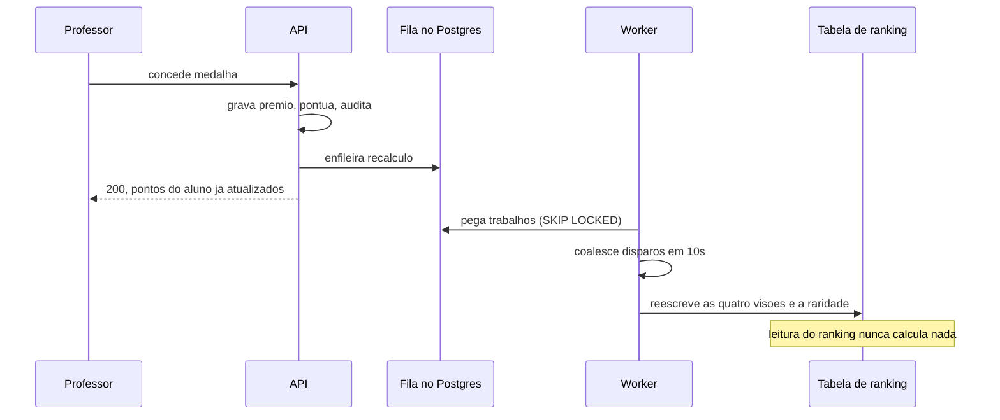

# ADR 0005 · Ranking e raridade em tabela, escritos pelo worker com coalescência

Status: aceito · 01/11/2026 · revisado em 02/11/2026 (eventos que enfileiram o recálculo)

## Contexto

São quatro visões de ranking (geral e por curso, cada uma em semestre atual e histórico),
3.200 alunos, e um alvo de p95 de 300 ms na leitura com 2.000 usuários virtuais. Não há
Redis. E existe um requisito de apresentação: na banca, uma medalha concedida ao vivo
precisa mexer a posição em segundos, e é o momento de maior impacto da demonstração.

A raridade dos itens (percentual de alunos que têm cada prêmio) tem exatamente a mesma
natureza: cálculo agregado, leitura muito frequente, tolerância a alguns segundos de
atraso.

## Opções

| Opção | Peso |
|---|---|
| **Tabela escrita pelo worker, recálculo disparado por evento com coalescência** | **9** |
| `MATERIALIZED VIEW` com `REFRESH CONCURRENTLY` em cron fixo | 5 |
| Cálculo na hora da consulta | 3 |

## Decisão

Uma tabela cobre as quatro visões, com pontos, posição e o instante do desempate. O
worker a reescreve quando um trabalho de recálculo é enfileirado, coalescendo disparos em
no máximo uma execução a cada dez segundos por visão. A raridade dos itens é recalculada
no mesmo worker, pelo mesmo gatilho.

O recálculo é enfileirado, na mesma transação da escrita, por **todo evento que muda a
pontuação** de algum aluno, não só pela medalha:

- concessão de medalha;
- aprovação de comprovação de prêmio de participação, e concessão direta pela
  instituição;
- contestação aberta (o prêmio entra em averiguação e para de pontuar);
- decisão da instituição sobre a contestação, confirmando ou revogando;
- anulação de medalha;
- conquista concedida ou removida pelo worker.

A coalescência é o que torna isso barato: uma rajada de eventos no mesmo intervalo vira
uma execução só por visão. O diagrama abaixo mostra a medalha, o caso da banca; os
outros eventos seguem o mesmo caminho, e os diagramas de `docs/fluxos/` mostram cada um.

## Consequências

- A leitura do ranking é um `SELECT` com índice, sem agregação: é o que sustenta o alvo de
  p95.
- Desempate por "instante da última concessão que compõe a pontuação atual" fica como
  coluna materializada, não como subconsulta.
- **Negativa:** a posição é eventualmente consistente. Existe uma janela de segundos em
  que o aluno vê os pontos novos e a posição antiga, e a interface precisa assumir isso
  sem parecer defeito.
- **Negativa:** o worker é ponto único de atraso. Se ele morre, o ranking congela **sem
  erro visível**: nenhuma tela quebra, os números só param. Precisa de verificação de
  saúde própria e de um alerta, senão o sintoma aparece primeiro na banca.
- **Negativa:** o congelamento do ranking semestral 30 dias após o fim do semestre passa a
  ser regra do worker, não da consulta: quem lê a tabela não sabe que ela parou de ser
  atualizada de propósito.
