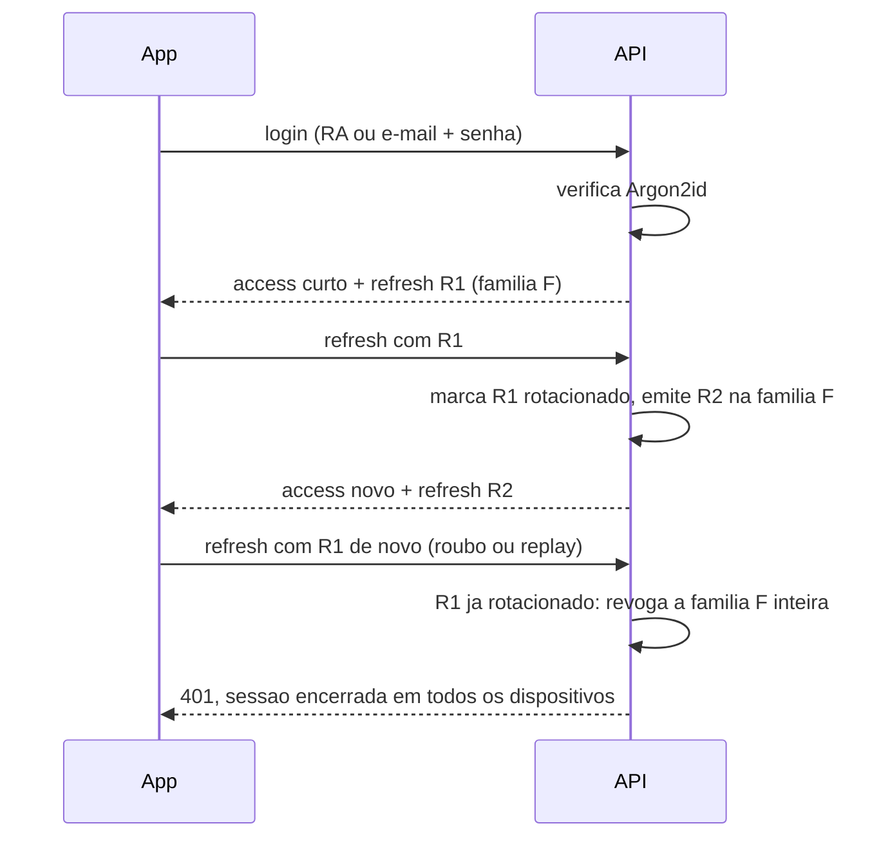

# ADR 0006 · Autenticação própria, com Argon2id e família de refresh

Status: aceito · 01/11/2026

## Contexto

São três papéis, login por RA ou e-mail institucional, senha com hash Argon2id, access
token curto em memória e refresh rotativo cujo reuso derruba a sessão inteira. O
ASP.NET Core Identity resolve hash, reset e confirmação de e-mail, mas não entrega
refresh rotativo com detecção de reuso, exatamente a parte que foi especificada.

## Opções

| Opção | Peso |
|---|---|
| **Módulo próprio**: tabela de usuários, Argon2id, JWT curto, família de refresh | **8** |
| ASP.NET Core Identity com `IPasswordHasher` customizado, mais refresh na mão | 6 |

E, dentro da decisão, o escopo do professor:

| Opção | Peso |
|---|---|
| **Escopo de turma checado no banco** a cada mutação | **9** |
| Lista de turmas dentro do JWT | 4 |

## Decisão

Módulo próprio. O access token é JWT curto com `sub` e papéis; a lista de turmas do
professor **não** entra no token e é verificada no banco, com índice, a cada concessão de
medalha, aprovação ou contestação. Na web o refresh fica em cookie `HttpOnly`; no nativo,
no secure store.

## Consequências

- O comportamento especificado existe exatamente como especificado, sem contornar
  framework.
- Turma revogada ao professor tem efeito imediato: não há token velho carregando permissão
  vencida.
- **Negativa:** é código de segurança escrito por nós. Expiração, revogação em logout,
  enumeração de usuário na tela de login, limite de taxa, fluxo de recuperação de senha,
  tudo isso é nossa responsabilidade e precisa de teste explícito. É o módulo onde um erro
  custa mais caro.
- **Negativa:** não herdamos confirmação de e-mail, bloqueio por tentativas nem segundo
  fator. A fase 2 pede confirmação de e-mail, e ela será implementada à mão ou exigirá
  migrar para o Identity depois, com dado em produção.
- **Negativa:** checar turma no banco é uma consulta a mais em cada mutação de prêmio.
  Aceitável porque mutação de prêmio é rara comparada à leitura do feed.
