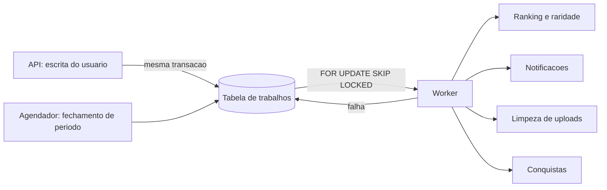

# ADR 0008 · Fila numa tabela do Postgres, sem broker e sem Redis

Status: aceito · 01/11/2026

## Contexto

Quatro coisas podem esperar alguns segundos: recálculo de ranking e raridade, notificação,
limpeza de upload abandonado e fechamento de período para as conquistas. Nenhuma delas o
usuário vê acontecer. Tudo que ele vê (publicar post, curtir, marcar aviso como lido,
receber a medalha) é síncrono. O orçamento da fase 1 é uma VPS, e o requisito foi
explícito: sem broker, sem Redis.

## Opções

| Opção | Peso |
|---|---|
| **Tabela de trabalhos no Postgres**, consumida com `FOR UPDATE SKIP LOCKED` | **9** |
| Redis com Hangfire ou similar | 5 |
| Broker dedicado (RabbitMQ, SQS) | 3 |

## Decisão

Uma tabela de trabalhos, com tipo, carga, estado, tentativas e instante de
disponibilidade. Um worker no mesmo compose consome com `SKIP LOCKED`, o que permite mais
de um consumidor sem corrida. O enfileiramento acontece na mesma transação da escrita que
o originou, então não existe trabalho perdido nem trabalho órfão.

## Consequências

- Uma peça de infraestrutura a menos para instalar, monitorar, fazer backup e explicar na
  banca.
- Transacionalidade de graça: se a escrita falha, o trabalho não existe.
- **Negativa:** o banco acumula a função de fila. Um pico de enfileiramento disputa I/O
  com as leituras do feed exatamente no evento, que é quando os dois acontecem juntos. É o
  primeiro lugar a olhar se o teste de carga não bater o alvo.
- **Negativa:** retentativa, recuo exponencial e tratamento de trabalho envenenado são
  código nosso. Sem isso, um trabalho que sempre falha gira para sempre.
- **Negativa:** não existe painel pronto. Observabilidade de fila é consulta SQL, e
  descobrir que o worker parou depende de verificação de saúde que precisamos escrever.
- **Negativa:** o worker roda no mesmo host das réplicas de API. Ele compete por CPU com
  quem atende requisição, e nada o isola além do limite do contêiner.
