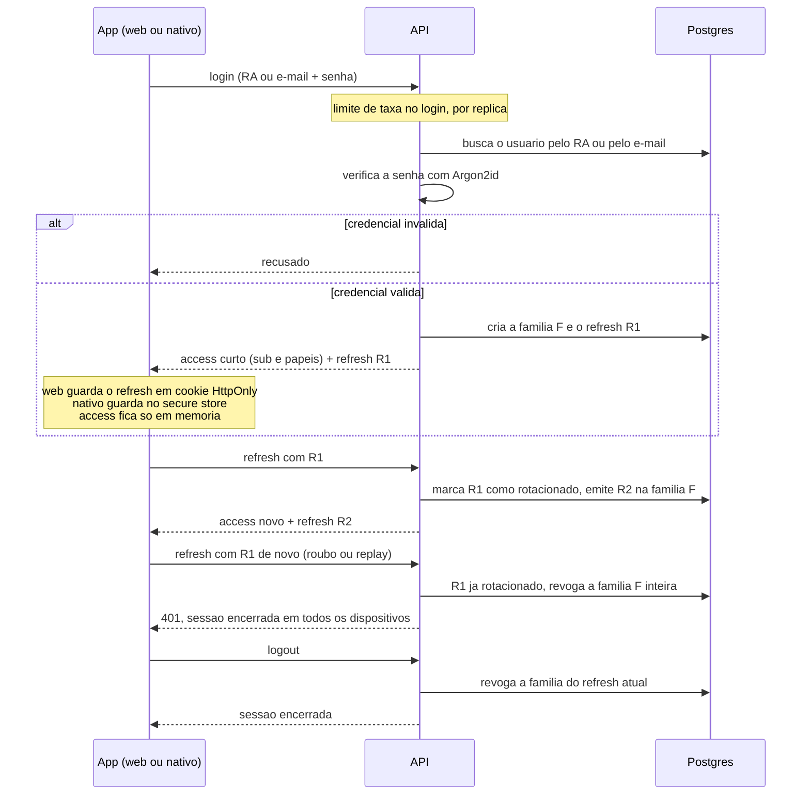

# Login, refresh rotativo e logout

Login próprio, sem cadastro público nem login social. O aluno entra por RA ou por
e-mail; professor e instituição, por e-mail. A API é do passo 3; as telas e a sessão no
cliente, do passo 5.

## De onde vem cada passo

| Passo | Fonte |
|---|---|
| RA ou e-mail para aluno; só e-mail para professor e instituição | `produto.md` 2.5 |
| Limite de taxa no login, por réplica, com o limitador nativo | `decisoes/README.md` (Limite de taxa); `plano-mestre.md` passo 3 |
| Argon2id; senha nunca em texto nem em log | ADR 0006; `CLAUDE.md` (Segurança) |
| Access curto com `sub` e papéis, sem a lista de turmas do professor | ADR 0006 |
| Refresh em cookie `HttpOnly` na web e no secure store no nativo | ADR 0006; cookie first-party pela origem única, ADR 0001 |
| Rotação por família; reuso de token já rotacionado derruba a família inteira | ADR 0006; `CLAUDE.md` (Segurança) |
| Logout revogando | `plano-mestre.md` passo 3 |

O papel do usuário vem do cadastro na base, nunca do domínio do e-mail (`produto.md`
2.4).

## Códigos HTTP

Toda recusa sai em ProblemDetails com a extensão `codigo`, que o cliente traduz em
mensagem amigável (`decisoes/README.md`, Formato de erro).

| Rota | Sucesso | Recusa |
|---|---|---|
| `POST /api/v1/auth/login` `{identificador, senha}` | 200 com a sessão | 401 `credenciais-invalidas`; 400 `dados-invalidos`; 429 `limite-de-taxa` |
| `POST /api/v1/auth/refresh` `{refreshToken}` | 200 com a sessão nova | 401 `sessao-invalida`; 400 `dados-invalidos` |
| `POST /api/v1/auth/logout` `{refreshToken}` | 204, sempre | 400 `dados-invalidos` |

- **Identificador:** com `@` é e-mail, de qualquer papel; sem `@` é RA, só de aluno.
- **`credenciais-invalidas`:** a mesma resposta, e o mesmo custo de um Argon2id, para
  usuário inexistente, conta do seed ainda sem senha, senha errada e professor ou
  instituição pelo RA. Nem o corpo nem o tempo dizem quem tem conta.
- **`sessao-invalida`:** refresh ausente, desconhecido, expirado, de família revogada ou
  reusado. No reuso, a família inteira cai antes da resposta, e dois refresh simultâneos
  com o mesmo token contam como reuso: o cliente serializa o refresh.
- **Sessão:** `accessToken` e `accessTokenExpiraEm`, `refreshToken` e
  `refreshTokenExpiraEm`. Com o cabeçalho `X-Maxx-Cliente: web`, o refresh vai só no
  cookie `maxx_refresh`, e `refreshToken` volta nulo; o refresh e o logout leem o
  cookie só com esse cabeçalho, e o corpo pode faltar.
- **Logout:** revoga a família do refresh apresentado; refresh desconhecido ou família já
  revogada não mudam a resposta. Na web, o refresh recusado e o logout apagam o cookie.
- **Limites:** login, 5 por minuto por identificador e 30 por minuto por IP; o 429 traz
  `Retry-After` (`decisoes/README.md`, Autenticação).

## No cliente (passo 5)

- **Access token só em memória.** Renovado antes de vencer, com 30 segundos de folga, e
  uma vez depois de um 401, com o pedido repetido uma vez só.
- **Um refresh por vez.** Quem chega durante a renovação espera o resultado dela. Na web,
  a Web Locks API põe as abas em fila: todas mandam o mesmo cookie, e duas renovações
  juntas seriam reuso.
- **Abertura do app.** Na web, a sessão é restaurada pelo cookie; no nativo, pelo refresh
  do secure store. `sessao-invalida` leva ao login; falha de rede mostra "Sem conexão",
  sem apagar a sessão guardada.
- **Telas.** `/login`, com o segmentado para `/cadastro` e o link para
  `/esqueci-senha`. Credencial errada aparece no campo da senha; limite de taxa e falta
  de rede, abaixo do botão.

Detalhes em `decisoes/README.md`, Autenticação no cliente.
