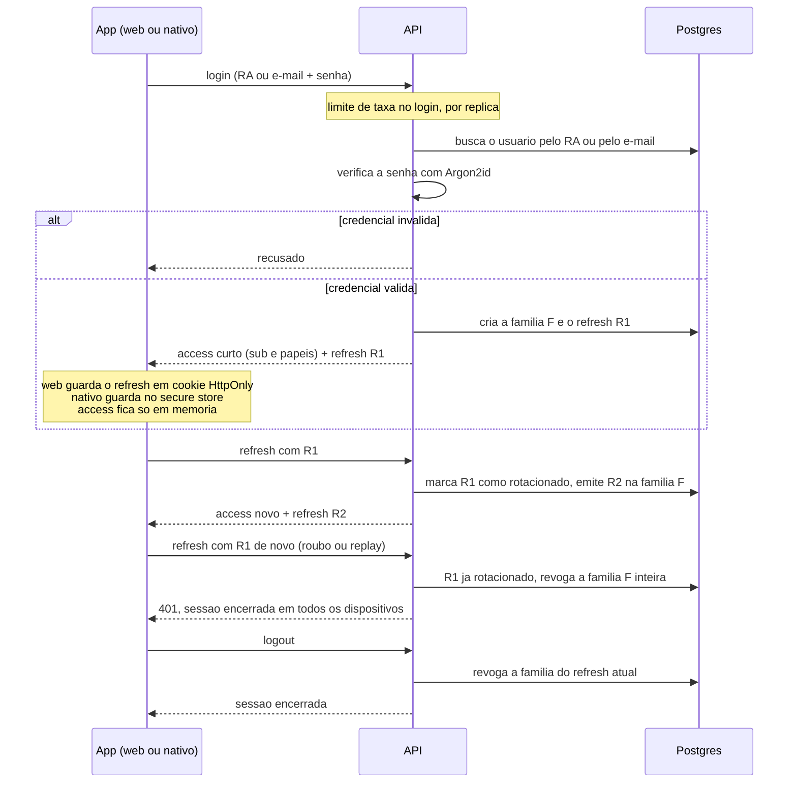

# Login, refresh rotativo e logout

Login próprio, sem cadastro público nem login social. O aluno entra por RA ou por
e-mail; professor e instituição, por e-mail. Implementado no passo 3.

## De onde vem cada passo

| Passo | Fonte |
|---|---|
| RA ou e-mail para aluno; só e-mail para professor e instituição | `produto.md` 2.5 |
| Limite de taxa no login, por réplica, com o limitador nativo | `decisoes/README.md` (Limite de taxa); `plano-mestre.md` passo 3 |
| Argon2id; senha nunca em texto nem em log | ADR 0006; `CLAUDE.md` (Segurança) |
| Access curto com `sub` e papéis, sem a lista de turmas do professor | ADR 0006 |
| Refresh em cookie `HttpOnly` na web e no secure store no nativo | ADR 0006; cookie first-party pela origem única, ADR 0001 |
| Rotação por família; reuso de token já rotacionado derruba a família inteira | ADR 0006; `CLAUDE.md` (Segurança) |
| Logout revogando | `plano-mestre.md` passo 3 |

O papel do usuário vem do cadastro na base, nunca do domínio do e-mail (`produto.md`
2.4). Os códigos HTTP e o texto das respostas ficam para o passo 3; o único fixado aqui
é o 401 do reuso de refresh, que vem do ADR 0006. A resposta de credencial inválida que
não permita enumerar usuários é responsabilidade registrada no mesmo ADR.
