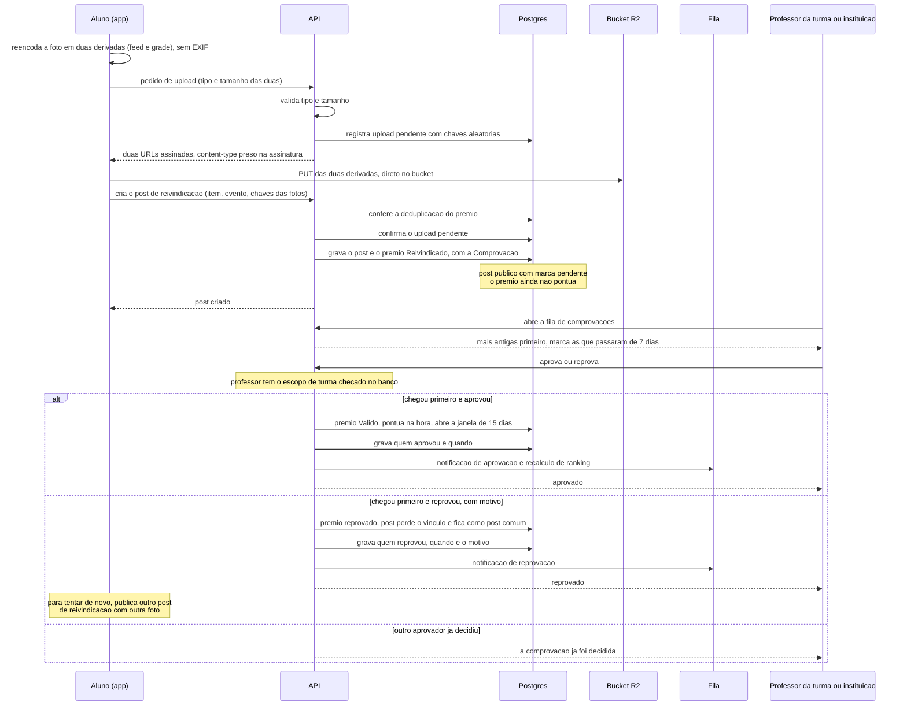

# Post com comprovação de prêmio de participação

A reivindicação de prêmio de participação é um post com foto, e a foto é a comprovação.
Por isso o post (passo 7) vem antes do prêmio de participação (passo 8). Este diagrama
vai da foto até a aprovação ou reprovação; o que acontece depois da aprovação está em
[`04-contestacao.md`](04-contestacao.md).

## De onde vem cada passo

| Passo | Fonte |
|---|---|
| Duas derivadas geradas no cliente (feed ~1080², grade ~320²), sem metadado de localização | ADR 0003 |
| API valida tipo e tamanho antes de assinar; assinatura prende o `content-type`; foto nunca passa pela API | ADR 0002; `CLAUDE.md` (Segurança) |
| Chave de objeto aleatória, porque a leitura é pública para quem tem o link | ADR 0002; `produto.md` 9.2 |
| Upload pendente registrado e confirmado ao criar o post; limpeza do abandonado na fila | ADR 0002; `plano-mestre.md` passo 7 |
| Um prêmio por evento; evento em texto livre bloqueia o mesmo item na mesma data; apresentação em sala deduplica por item, data e matéria | `produto.md` 4.6 |
| Post público desde o envio, com marca "pendente", sem pontuar | `produto.md` 4.7 e 9.1 |
| Aprovam o professor de qualquer turma do aluno no semestre vigente ou a instituição; vale quem chega primeiro | `produto.md` 4.7 |
| Fila ordenada por mais antigo, com marca após 7 dias, sem decisão automática | `produto.md` 4.7 e 12.6 |
| Escopo de turma do professor checado no banco, nunca lido do token | ADR 0006; `CLAUDE.md` (Segurança) |
| Aprovado pontua na hora e abre a janela de 15 dias | `produto.md` 4.7 |
| Reprovação com motivo; nova tentativa é outro post de reivindicação, com outra foto; cada reivindicação tem um post e uma foto só | `produto.md` 4.7; `plano-mestre.md` passo 8 |
| Reprovado: o post perde o vínculo com o prêmio e permanece como post comum | `produto.md` 4.7 (parágrafo final) |
| Auditoria de aprovação e reprovação | `produto.md` 4.10 |
| Notificação de aprovação e reprovação, assíncrona | `produto.md` 8; ADR 0008 |
| Recálculo de ranking enfileirado pela aprovação, na mesma transação | ADR 0005 (eventos que enfileiram o recálculo); ADR 0008 |
| `Comprovacao` filtrável por evento, pensando no lote da fase 2 | `produto.md` 13 |

A instituição também pode conceder prêmio de participação direto, já aprovado e sem
comprovação (`produto.md` 4.7). Esse caminho não tem foto nem fila e fica fora deste
diagrama.
