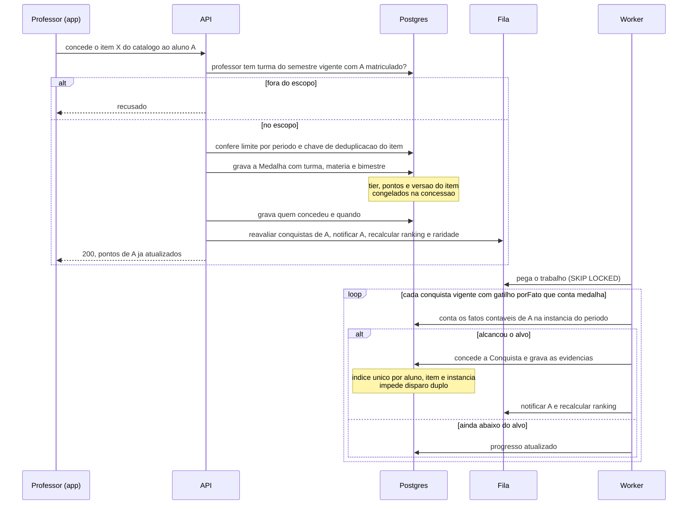
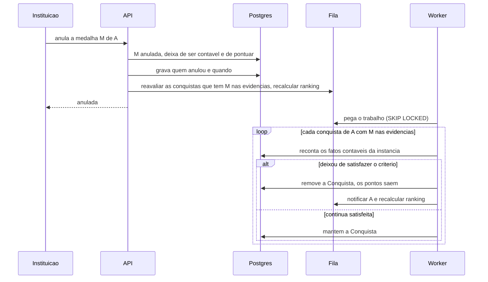

# Concessão de medalha com recálculo de conquistas

Medalha é concessão humana do professor, sobre fato de nota ou presença. A concessão é
síncrona; as conquistas que ela pode fechar são avaliadas depois, no worker. A
concessão chega no passo 6; o avaliador de conquistas, no passo 9. A seção "No passo 6", no
fim, diz o que já roda e o que ainda é desenho.

## Anulação

A instituição anula a medalha concedida por erro. A conquista nunca é revogada: ela é
recalculada.

## De onde vem cada passo

| Passo | Fonte |
|---|---|
| Professor concede pelo perfil do aluno, escolhendo o item do catálogo; ninguém digita valor nem tier | `produto.md` 4.2 e 4.8 |
| Só nas turmas do semestre vigente; escopo checado no banco a cada concessão | `produto.md` 4.8; ADR 0006 |
| Limite por período e chave de deduplicação | `plano-mestre.md` passo 6; `produto.md` 4.5 (regra de deduplicação do item) |
| Medalha grava turma e matéria do professor e bimestre da data | `produto.md` 4.8 |
| Tier, pontos e versão do item congelados; raridade não | ADR 0007; `produto.md` 4.2 |
| Auditoria de concessão e de anulação | `produto.md` 4.10 |
| Enfileiramento na mesma transação; 200 já com os pontos; recálculo de ranking pela concessão, pela anulação e pela conquista concedida ou removida | ADR 0005 (eventos que enfileiram o recálculo); ADR 0008 |
| Notificação de medalha recebida | `produto.md` 8 |
| Gatilho `porFato`: avalia assim que o fato se torna contável | `regras-conquista.md` 5 |
| Contagem dentro da instância do período, sem atravessá-la | `regras-conquista.md` 3 e 4; `produto.md` 4.9 |
| Concede ao alcançar ou passar o alvo; grava as evidências | `regras-conquista.md` 1 e 6 |
| Índice único `(aluno, item, tipoDePeriodo, referenciaDoPeriodo)` | `regras-conquista.md` 4 |
| Progresso ("2 de 3") quando ainda abaixo do alvo | ADR 0004; `produto.md` 4.5 |
| Avaliação sempre no worker, nunca na requisição | `regras-conquista.md` 5 |
| Anulação: ato administrativo, sem motivo público e sem averiguação | `produto.md` 4.8 |
| Medalha anulada deixa de ser contável no instante da anulação | `regras-conquista.md` 3 |
| Reavalia só as conquistas que têm a medalha nas evidências; remove, tira os pontos e notifica | `regras-conquista.md` 6 |

As conquistas de gatilho `fechamentoDePeriodo` não disparam pela concessão: elas rodam
no fechamento da instância e são reavaliadas quando um fato do período chega depois do
fechamento, até o congelamento do ranking do semestre (`regras-conquista.md` 5).

## No passo 6

O que já roda: a concessão pela lista da turma, a anulação por comando administrativo, a
notificação de medalha recebida e o recálculo de raridade no worker. Ainda é desenho: a
reavaliação de conquistas (passo 9) e o recálculo do ranking (passo 11). Por isso a
concessão e a anulação enfileiram hoje só `notificar-medalha-recebida` (a concessão) e
`recalcular-raridade` (as duas). Decisões em `decisoes/README.md`, Medalhas, fila e
worker (passo 6).

| Rota | Sucesso | Recusa |
|---|---|---|
| `GET /api/v1/professor/turmas` | 200, as turmas do semestre vigente do professor | 403 `sem-permissao` para quem não é professor |
| `GET /api/v1/professor/turmas/{turmaId}/alunos` | 200, os alunos com conta e não ex-alunos, com as medalhas ativas na turma | 403 `fora-do-escopo` |
| `GET /api/v1/professor/medalhas` | 200, as medalhas do catálogo vigentes hoje | 403 `sem-permissao` |
| `POST /api/v1/professor/turmas/{turmaId}/medalhas` `{alunoId, item}` | 201, com tier, pontos e ocorrência | 403 `fora-do-escopo`; 404 `aluno-fora-da-turma`, `item-nao-encontrado`; 409 `ex-aluno`, `fora-do-periodo`, `item-fora-de-vigencia`, `item-de-outro-curso`, `limite-atingido`; 400 `dados-invalidos` |
| `GET /api/v1/eu/premios` | 200, o catálogo do próprio aluno com critério, raridade e o que ele obteve | 403 para quem não é aluno |

A anulação é o comando `Maxx.Api anular-medalha <id> --instituicao <e-mail>`, que sai com 0
quando a medalha fica anulada ou já estava, 1 quando recusa e 2 quando o uso está errado.
