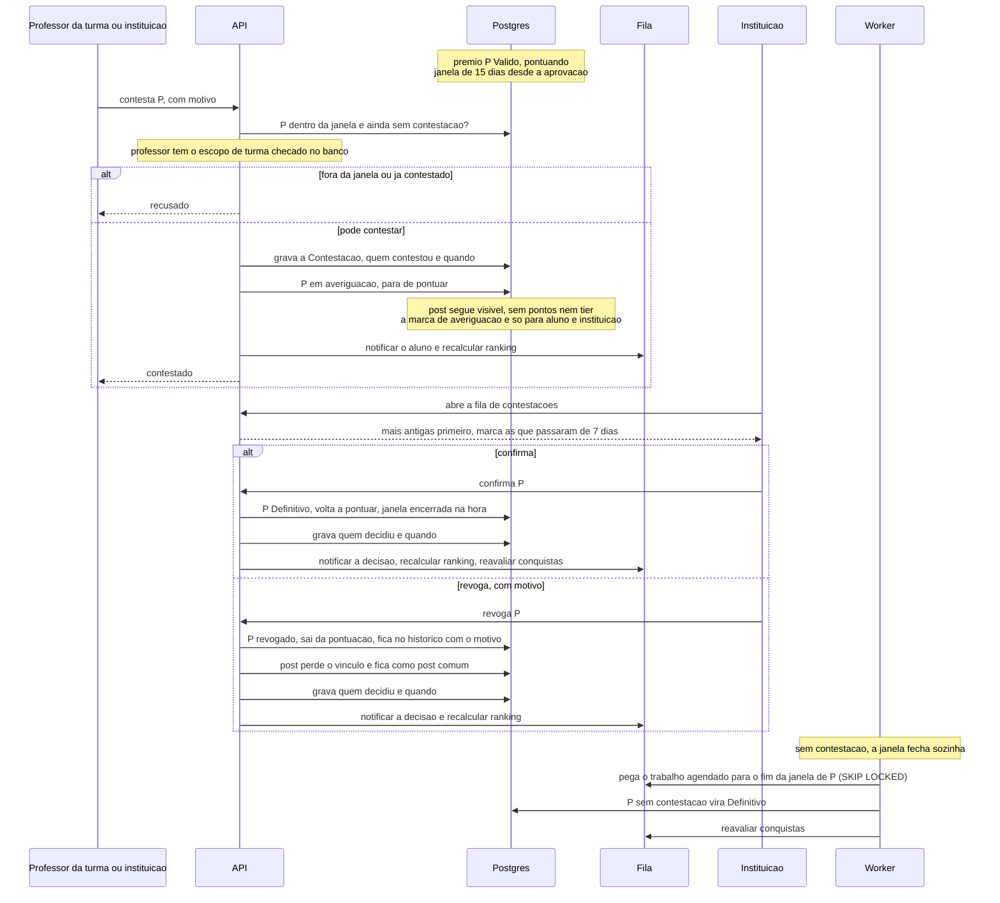

# Contestação de prêmio de participação

O prêmio de participação aprovado fica válido e pontuando, com uma janela de 15 dias para
contestação. Só ele é contestável. Quem decide a contestação é sempre a instituição.
Implementado no passo 8.

## De onde vem cada passo

| Passo | Fonte |
|---|---|
| Prêmio de participação é o único contestável; medalha não | `produto.md` 4.1; `CLAUDE.md` (Glossário) |
| Janela de 15 dias a partir da aprovação | `produto.md` 4.7 |
| Contestam o professor da turma (inclusive quem aprovou) ou a instituição, sempre com motivo | `produto.md` 4.7 |
| Uma contestação por prêmio | `produto.md` 4.7 |
| Escopo de turma do professor checado no banco | ADR 0006 |
| Em averiguação não pontua; visível ao aluno e à instituição | `produto.md` 4.7 e 9.1 |
| Em averiguação, o post continua visível, sem pontos nem tier | `produto.md` 4.7 (parágrafo final) |
| Notificação de contestação aberta e de decisão | `produto.md` 8 |
| Quem decide é sempre a instituição | `produto.md` 4.7 |
| Fila por mais antigo, marca após 7 dias, sem decisão automática por decurso | `produto.md` 4.7 e 12.6 |
| Confirmado: definitivo, volta a pontuar, janela encerra, não pode mais ser contestado | `produto.md` 4.7 |
| Revogado: sai da pontuação, fica no histórico com o motivo, visível ao aluno e à instituição | `produto.md` 4.7 e 9.1 |
| Revogado: o post perde o vínculo com o prêmio e fica como post comum | `produto.md` 4.7 (parágrafo final) |
| Auditoria de contestação, decisão e revogação | `produto.md` 4.10 |
| Sem contestação, trabalho na fila torna definitivo após 15 dias | `produto.md` 4.7; `plano-mestre.md` passo 8 |
| Só prêmio definitivo conta para conquista; virar definitivo dispara a reavaliação | `produto.md` 4.7; `regras-conquista.md` 3 e 5; ADR 0004 |
| Recálculo de ranking enfileirado pela contestação e pela decisão, na mesma transação | ADR 0005 (eventos que enfileiram o recálculo); ADR 0008 |

Prêmio revogado nunca chega a ser evidência de conquista, porque só conta depois de
definitivo e, depois de definitivo, não pode mais ser contestado
(`regras-conquista.md` 6).

## Como ficou no passo 8

- A contestação e a decisão enfileiram a notificação e o recálculo de raridade. O recálculo
  de ranking chega no passo 11, e a reavaliação de conquistas, que o trabalho do fim da
  janela e a confirmação devem disparar, no passo 9.
- A instituição também revoga sem contestação, quando remove o post de um prêmio válido; em
  averiguação, remover o post decide a contestação revogando. O motivo é "Removido pela
  instituição." (`produto.md` 4.7).
- Em averiguação, o post aparece sem o prêmio para quem não é o aluno nem a instituição.
- Rotas, códigos e decisões em `decisoes/README.md`, Prêmios de participação (passo 8).
