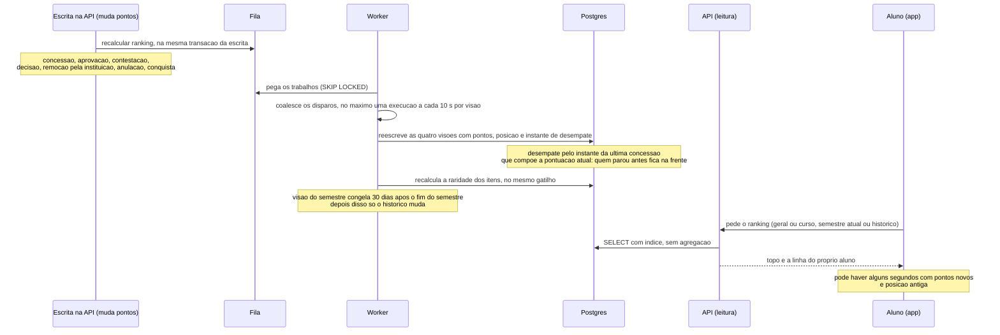

# Ranking

O ranking é pré-calculado: o worker escreve, a leitura só lê. São quatro visões (geral e
por curso, cada uma em semestre atual e histórico) numa tabela só. Implementado no
passo 11.

## De onde vem cada passo

| Passo | Fonte |
|---|---|
| Quatro visões: geral e por curso, semestre atual e histórico | `produto.md` 5; ADR 0005 |
| Tabela escrita pelo worker; recálculo enfileirado por todo evento que muda pontuação | ADR 0005 (eventos que enfileiram o recálculo) |
| Enfileiramento na mesma transação da escrita | ADR 0008 |
| Coalescência de no máximo uma execução a cada 10 s por visão | ADR 0005 |
| Desempate pelo instante da última concessão que compõe a pontuação atual, como coluna materializada | `produto.md` 5; ADR 0005 |
| Raridade recalculada no mesmo worker, pelo mesmo gatilho | ADR 0005; `produto.md` 4.3 |
| Congelamento da visão semestral 30 dias após o fim do semestre, como regra do worker | `produto.md` 5; ADR 0005 |
| Leitura é `SELECT` com índice, sem agregação | ADR 0005 |
| Cada tela mostra o topo e a linha do próprio aluno, em destaque | `produto.md` 5 |
| Posição eventualmente consistente: pontos novos com posição antiga por alguns segundos | ADR 0005 |

Regras do ranking que não aparecem como passo, mas valem para o que o worker escreve
(`produto.md` 5): o ranking é só posição numérica, o aluno não tem tier; ninguém sai do
ranking; ex-aluno aparece só no histórico; o aluno que troca de curso leva os pontos
para o ranking do curso novo; na virada do semestre, o ranking do semestre começa do
zero e o histórico acumula. Pontos congelam na concessão (ADR 0007), então reajuste de
catálogo não move nenhuma posição.

Se o worker morre, o ranking congela sem erro em tela (ADR 0005). A verificação de saúde
e o alerta ficam para o passo 13.

## Como ficou no passo 11

- **Tabela:** `posicao_no_ranking`, uma linha por aluno em cada visão em que ele tem
  pontos: escopo, período, semestre (só no período semestre), curso (só no escopo curso),
  posição, pontos e `ultima_concessao_em`. Aluno sem pontos não tem linha.
- **Escrita:** o trabalho `recalcular-ranking`, com a própria linha em `recalculo` e a
  coalescência do recálculo de raridade. Reescreve o histórico e os semestres ainda não
  congelados; o congelado fica como estava. O seed base pede um recálculo quando o
  calendário muda ou o ranking nunca foi calculado.
- **O que pontua e onde:** a medalha ativa, no semestre da concessão; o prêmio de
  participação válido ou definitivo, no semestre do início do evento; a conquista não
  removida, no semestre da instância (a de ano no segundo semestre; a de curso no da
  concessão). Regras em `produto.md` 4.9 e 5.
- **Leitura:** `GET /v1/rankings?escopo=&periodo=&seguidos=&cursor=`, 20 por página, com a
  linha do próprio aluno à parte. O perfil, o autor do post e Troféus trazem a posição do
  histórico geral.
- **Entrada:** pela posição no perfil e em Troféus, que abrem o histórico, e pelos atalhos
  da Busca.
- Decisões em `decisoes/README.md`, Rankings (passo 11).
