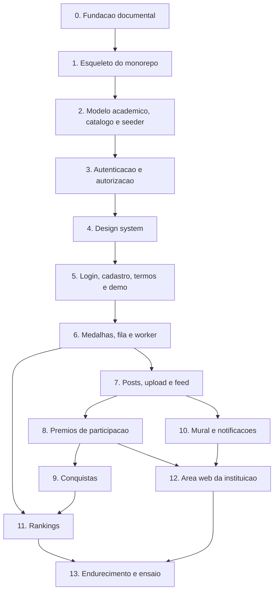

# Plano mestre do Maxx

Treze passos da fase 1, o protocolo de trabalho e a definição de pronto. Regras de
produto em [`produto.md`](produto.md), decisões técnicas em
[`decisoes/`](decisoes/README.md), catálogo em `data/catalogo/`.

---

## 1. Como trabalhamos

1. Antes de cada passo, sai um **plano de etapas** com entrega e critério de aceite por
   etapa.
2. O autor revisa o plano, ajusta se precisar, e só então a primeira etapa começa.
3. Cada etapa termina em **revisão humana do autor** antes do commit.
4. Um commit por etapa. Um PR por passo.
5. Nenhum código antes do plano de etapas aprovado.

Branch: `<tipo>/<assunto-em-kebab>`, com `feat`, `fix`, `docs`, `chore`, `refactor`,
`test`, `ci`. Commit convencional: `<tipo>(<escopo>): <assunto>`, escopos `api`, `mobile`,
`client`, `seed`, `infra`, `docs`, `design`. As branches saem da rodada e voltam para ela
por PR; a rodada vai para a `main` pelo autor.

Padrão de texto em `docs/`: sem travessões. Vírgula, dois pontos ou parênteses.

## 2. Definição de pronto

Um passo está pronto quando:

- testes passando nas camadas que ele tocou: unitário no domínio, integração com Postgres
  real, e2e quando houver fluxo de tela;
- lint e formatação limpos;
- migration criada e aplicada;
- OpenAPI regenerado e o cliente TypeScript sem diferença pendente;
- p95 medido, quando o passo tiver decisão de cache;
- **revisão humana do autor**.

## 3. Duas regras de planejamento

**O esquema cresce por passo.** Cada passo traz a sua migration, em vez de uma migration
grande no passo 2. É mais honesto com TDD e evita modelar no vazio tabelas que só serão
usadas seis passos depois. Consequência: o seed de demonstração também cresce por passo, e
só fica completo no passo 12.

**A ordem segue a dependência de dados, não a de telas.** Em particular, a comprovação de
prêmio de participação é um post com foto, então o post vem antes do prêmio de
participação. Isso inverte a ordem que eu havia proposto antes de escrever o catálogo.

---

## 4. Os treze passos

### Passo 0. Fundação documental

Gravar no repositório tudo que foi decidido, para qualquer sessão futura herdar sem
repetição.

- `docs/produto.md`: regras de produto da fase 1.
- `data/catalogo/`: 46 itens em quatro arquivos, com famílias de trilha.
- `docs/regras-conquista.md`: as duas formas de contagem e o contrato do avaliador.
- `docs/decisoes/`: oito ADRs e o índice de decisões.
- `docs/plano-mestre.md`: este arquivo.
- `CLAUDE.md`: as regras operacionais na raiz.

Sem código executável.

### Passo 1. Esqueleto do monorepo

Ponta a ponta vazio, mas vivo: a web abre, bate na API e recebe 200.

- `Maxx.sln` na raiz; `apps/api` com os quatro projetos; `apps/mobile` com Expo e Expo
  Router; `packages/api-client` gerado; `design/` já existe; `docker-compose.yml`.
- Caddy servindo o build web em `/` e fazendo proxy de `/api`.
- `/health` e `/ready` na API; contêiner de migration separado, com advisory lock.
- Lint e formatação nos dois lados, desde o primeiro commit.
- CI no GitHub Actions com os seis jobs: api, mobile, api-client, e2e, segurança, build.
- `.gitignore`, `.editorconfig`, `.env.example`. Segredo nenhum no repositório.
- Moldura de largura de celular no desktop.
- `docs/fluxos/`: diagramas de sequência de login, post com comprovação, concessão de
  medalha com recálculo de conquistas, contestação e ranking.

### Passo 2. Modelo acadêmico, catálogo e seeder

- Migrations de curso, ano letivo, semestre, bimestre, matéria, turma, vínculo de
  professor, matrícula, cadastro elegível e catálogo.
- Seeder idempotente por comando, com perfis `base` e `demo`, carregando os 46 itens pelo
  código.
- Calendário de 2026 com datas reais de semestre e bimestre.
- Validação do catálogo na CI: faixas de tier, códigos únicos, famílias coerentes,
  referências de `filtroItens` existentes.
- Testes de integração com Postgres real.
- Primeiros testes de domínio em `Maxx.Domain.Tests`, e com eles a remoção do
  `--ignore-exit-code 8` do `.csproj`, posto no passo 1 só porque o projeto nasceu sem
  teste.

### Passo 3. Autenticação e autorização

- Cadastro conferindo RA e e-mail na mesma linha do cadastro elegível; um RA, uma conta.
- Geração e unicidade do arroba, com sufixo por papel e reserva permanente do antigo.
- Login por RA ou e-mail; Argon2id; access token curto; refresh rotativo por família com
  detecção de reuso; logout revogando.
- Papéis e escopo de turma do professor checado no banco.
- Limite de taxa em login, upload e registro de demonstração.
- Flag da demonstração: desligada por padrão, rotas em 404 quando desligada, ausente da
  configuração de produção.
- Recuperação de senha por e-mail.

### Passo 4. Design system

- `tokens.json` tipado, tema claro e escuro, troca de tema.
- Archivo instanciado em largura óptica 112% e embarcado; Instrument Sans.
- Componentes: botão discreto e grande, campo com mostrar senha, controle segmentado,
  chip de filtro, navegação de cinco abas com realce e bolinha de novidade, medalhão com
  tier e raridade, selo de pílula do post, faixa de prêmio, trilha com cadeado, avatar de
  iniciais, estado vazio, estado de erro amigável.
- Grade de 4 px, margem lateral de 16, respiro de 24 antes da navegação.
- Ícones e splash reais do app, no lugar dos PNGs padrão do template Expo que ficaram em
  `apps/mobile/assets` desde o passo 1.

### Passo 5. Login, cadastro, termos e entrada da demonstração

Primeiras telas reais, fechando o ciclo entre autenticação e design.

- Login e cadastro em claro e escuro, conforme as pranchetas.
- Aceite do termo de uso versionado, dentro da identidade visual.
- Entrada da demonstração: botão só com a flag ligada, registro simples, lembrança local
  do dispositivo.
- Refresh serializado no cliente, obrigatório: um refresh por vez, e o pedido que chega
  durante espera o resultado do que já está em voo. Dois refresh simultâneos com o mesmo
  token contam como reuso e derrubam a sessão (`decisoes/README.md`, Refresh simultâneo).
- Debounce na sugestão e na disponibilidade do arroba, que somam 60 consultas por minuto
  por IP.
- Tela de senha nova em `/redefinir-senha`, lendo o token do fragmento `#token=`.
- e2e de cadastro, login, recuperação de senha e entrada de demonstração.

### Passo 6. Medalhas, fila e worker

É aqui que nasce a infraestrutura assíncrona.

- Lista de turmas e alunos do professor; modal de concessão a partir do catálogo.
- Concessão gravando matéria, bimestre, tier e pontos do momento, com limite por período
  e chave de deduplicação respeitados.
- Auditoria de concessão e de anulação.
- Fila na tabela do Postgres e worker consumindo com `SKIP LOCKED`.
- Notificação de medalha recebida, gravada no banco.
- Tela de Troféus com o catálogo, o que falta, o critério e a raridade por escassez,
  recalculada no worker.
- Anulação de medalha pela instituição, por enquanto por comando administrativo.
- Envio de e-mail migrado da fila em memória do passo 3 para a fila do Postgres, com o
  token de recuperação emitido no worker.
- Navegação de cinco abas, com Busca, Mural e Perfil em "Em breve" até os passos 7 e 10.

Fica pendente: a posição no ranking, que chega no passo 11. Decisões do passo em
`decisoes/README.md`, Medalhas, fila e worker (passo 6).

### Passo 7. Posts, upload e feed

- Assinatura de upload com tipo e tamanho presos; duas derivadas geradas no cliente;
  limpeza de upload abandonado na fila.
- Post com ao menos um entre prêmio, foto e legenda; um prêmio rende um post.
- Feed por cursor com índice, intercalando seguidos e recomendação com semente de sessão.
- Curtida, comentário, remoção de comentário por autor e por instituição.
- Seguir e deixar de seguir, livre.
- Perfil com grade de três colunas, abas por ícone, pontos e prêmios.
- Busca de alunos por nome de exibição e arroba, com filtros de curso e semestre.
- Editar perfil: foto, nome de exibição e a parte do arroba antes do hífen.
- Deep link `/post/:id` atrás do login.
- Limite de upload aplicado e testado; controle de tema no menu do perfil; anel dourado no
  próprio avatar; foto opcional na demonstração.

Ficam pendentes: os posts semeados, que precisam das contas de aluno do seed completo
(passo 12), e a remoção das fotos do lote no bucket, que o SQL da purga não alcança
(passo 12). Decisões do passo em `decisoes/README.md`, Posts, upload e feed (passo 7).

### Passo 8. Prêmios de participação

- Catálogo de eventos semeado, mais evento em texto livre com nome e período.
- Reivindicação como post com foto, pública com marca de pendente, sem pontuar.
- Fila de comprovações para o professor da turma e para a instituição, ordenada por mais
  antigo, com marca após sete dias, resolvendo a corrida de quem aprova primeiro.
- Reprovação com motivo; nova tentativa é outro post de reivindicação, com outra foto.
- Contestação com motivo, uma por prêmio, estado de averiguação sem pontuar.
- Decisão da instituição: confirmar encerra a janela, revogar mantém no histórico.
- Trabalho na fila que torna o prêmio definitivo após quinze dias.
- `Comprovacao` filtrável por evento, já pensando na aprovação em lote da fase 2.

Ficam pendentes: a concessão direta pela instituição e as telas dela (fila de
contestações, confirmar e revogar), no passo 12, que já tem a API pronta (D7); o texto das
notificações de comprovação, contestação, decisão e revogação, e o sininho, no passo 10; o
recálculo do ranking que a aprovação, a contestação, a decisão e a remoção pela instituição
devem enfileirar (ADR 0005), e a regra de em que semestre o prêmio conta (D4), no passo 11;
a reavaliação de conquistas quando o prêmio fica definitivo, no passo 9; os eventos
passados e futuros do seed completo, no passo 12. Decisões do passo em
`decisoes/README.md`, Prêmios de participação (passo 8).

### Passo 9. Conquistas

- Avaliador das duas formas de contagem, lendo a regra do catálogo.
- Gatilho por fato e por fechamento de período; reavaliação até o congelamento do
  semestre.
- Evidências gravadas por conquista concedida.
- Recálculo na anulação de medalha, removendo conquista que deixou de ser satisfeita.
- Progresso "2 de 3" na tela de Troféus.
- Índice de unicidade por instância de período.
- Um teste por forma, um por item e os testes de fronteira previstos em
  `regras-conquista.md`.
- Do passo 8: reavaliar as conquistas quando o prêmio de participação fica definitivo,
  pelo fim da janela de 15 dias (trabalho `tornar-premio-definitivo`) ou pela confirmação
  da contestação.
- Entrou também, aprovado no plano do passo: o post de conquista, porque um prêmio rende
  um post (produto.md 6.1).

Ficam pendentes: o recálculo do ranking pela conquista concedida ou removida (passo 11); o
texto das notificações `conquistaObtida` e `conquistaRemovida`, já gravadas, e a
bolinha de Troféus (passo 10); conquistas no seed de demonstração (passo 12). Decisões do
passo em `decisoes/README.md`, Conquistas (passo 9).

### Passo 10. Mural e notificações

- Aviso nos três escopos; professor seleciona uma ou mais turmas suas.
- Texto com imagem opcional; somente leitura.
- Registro de leitura e bolinha dourada na aba Mural.
- Sininho no cabeçalho do feed, com as notificações de medalha, aprovação, reprovação,
  contestação, decisão e aviso novo. A de medalha recebida já é gravada desde o passo 6.
- Do passo 9: o texto das notificações de conquista obtida e de conquista removida pelo
  recálculo, já gravadas pelo worker.
- Bolinha de prêmio novo na aba Troféus.
- Entrou também, aprovado no plano do passo: o título do aviso (a prancheta tem título e
  corpo), o "Ler todos" e o sininho no cabeçalho do Mural, que estão na prancheta; o perfil
  do professor com os avisos que publicou (`produto.md` 2.1); a tela de notificações e o
  novo aviso do professor como superfícies sem prancheta.

Ficam pendentes: a tela da instituição para publicar aviso de faculdade e de curso, com a
API pronta, e os avisos no seed de demonstração (passo 12); o p95 do mural com ETag e das
novidades perguntadas a cada 60 s (passo 13). Decisões do passo em `decisoes/README.md`,
Mural e notificações (passo 10).

### Passo 11. Rankings

- Tabela das quatro visões escrita pelo worker, com coalescência.
- Desempate pelo instante da última concessão que compõe a pontuação atual.
- Congelamento do ranking semestral trinta dias após o fim do semestre.
- Entrada pelo toque na própria posição no perfil e pelos atalhos da Busca.
- Filtro entre semestre atual e histórico; topo e linha do próprio aluno em destaque.
- Ex-aluno só no histórico.
- Do passo 8: o recálculo do ranking enfileirado também pela aprovação de comprovação,
  pela contestação, pela decisão da instituição e pela remoção do post pela instituição
  (ADR 0005), e a regra de em que semestre o prêmio de participação conta (D4); hoje o
  prêmio guarda só as datas do evento.
- Do passo 9: o recálculo do ranking também pela conquista concedida ou removida (ADR
  0005). A regra do semestre do prêmio de participação já foi decidida (produto.md 4.9: o
  semestre que contém o início do evento; no recesso, o seguinte), e o calendário a
  responde em `Calendario.SemestreDoEvento`. O congelamento reaproveita
  `InstanciaDePeriodo.DiasAteOCongelamento` e a mesma leitura: no dia do fim mais 30, já
  congelado. A conquista pontua no semestre da instância dela.
- Entrou também, aprovado no plano do passo: o "Quem eu sigo" da prancheta, filtrando a
  mesma visão sem mudar a posição de ninguém; e, aprovado na etapa 5, a posição do
  histórico geral no autor do post do feed e no cabeçalho de Troféus, que também abre o
  ranking, como estão nas pranchetas.

Ficam pendentes: marcar ex-aluno e trocar de curso pedirem o recálculo do ranking, que o
worker já respeita (passo 12); o p95 da leitura do ranking e da posição no perfil e no feed,
e a verificação de saúde do worker (passo 13). Decisões do passo em `decisoes/README.md`,
Rankings (passo 11).

### Passo 12. Área web da instituição

- Fila de comprovações e fila de contestações, com aprovar, reprovar, confirmar e
  revogar.
- Conceder prêmio de participação já aprovado.
- Publicar aviso de faculdade e de curso.
- Anular medalha; corrigir e-mail de aluno; marcar ex-aluno.
- Purgar dados de demonstração por lote, em uma transação, com as fotos do lote (posts e
  fotos de perfil) removidas do bucket, que o SQL sozinho não alcança (D14 do passo 7).
- Seed de demonstração completo: 150 alunos, 120 ativos distribuídos por semestres e 30
  ex-alunos, quatro cursos, turmas, matérias, professores, posts com foto, prêmios
  distribuídos de modo que as quatro raridades apareçam, avisos, eventos passados e
  futuros, duas comprovações pendentes e uma contestação aberta. Os posts semeados, que o
  passo 7 deixou para cá (D13), nascem com as contas desses alunos.
- Do passo 9: conquistas no seed, que nascem do worker a partir das medalhas e dos prêmios
  semeados (reavaliação e fechamento), e não gravadas à mão: é o que mantém evidências e
  progresso coerentes. A anulação pela área web enfileira o mesmo recálculo do comando
  administrativo.
- Do passo 10: a publicação de aviso de faculdade e de curso pela área web usa
  `POST /v1/avisos`, que já recebe os dois escopos e um ou mais cursos; a foto sobe pela
  finalidade `aviso` do upload. Sugestão para o plano do passo 12, ainda não decidida: os
  avisos do seed nascerem pela mesma publicação, para a notificação de aviso novo ir aos
  destinatários pelo worker, como as conquistas do seed nascem do worker.
- Do passo 11: marcar ex-aluno e trocar de curso enfileiram `fila.PedirRecalculos()` na
  mesma transação do ato. O worker já tira o ex-aluno das visões de semestre e leva os
  pontos para o curso novo (`Usuario.MarcarExAluno`, `Usuario.TrocarDeCurso` e o curso do
  cadastro elegível); falta só o pedido. A concessão direta da instituição também pede o
  recálculo, e o instante dela é o do desempate.

### Passo 13. Endurecimento e ensaio

- k6 a 2.000 usuários virtuais, p95 medido em feed, perfil e ranking. Micro-cache da
  primeira página do feed só se o número pedir. Do passo 7: o p95 do trecho de
  recomendação, que ordena sem índice; se o planejador escolhe o índice do feed com volume
  real (o teste dele desliga a varredura); e se a busca usa os índices de trigramas. Do
  passo 10: o p95 do mural, com a ETag, e o das novidades, que cada aluno pergunta ao
  voltar ao foco e a cada 60 s (a 2.000 usuários, cerca de 33 pedidos por segundo só
  delas). Do passo 11: o p95 de `GET /v1/rankings`, sem ETag, e o do perfil e do feed, que
  passaram a ler a posição do autor pelo índice do aluno.
- CSP do build web liberando o domínio da CDN das fotos em `img-src` e o endpoint do R2 em
  `connect-src`, para o PUT direto do navegador.
- R2 de verdade: rodar uma vez o `VerificacaoDoR2Tests`, que confere tipo e tamanho presos
  na assinatura, leitura pela CDN sem login, remoção e o CORS do PUT.
- Privilégio de `CREATE EXTENSION` do usuário do banco na VPS: a migration do passo 7 cria
  `unaccent` e `pg_trgm`. Revisar se a VPS usar um usuário com menos privilégio que o dono
  do banco.
- Verificação de saúde do worker e alerta de fila parada, pelo defeito silencioso
  descrito no ADR 0005, e de trabalho que ficou `falho` na fila.
- CSP, HSTS e cabeçalhos de segurança; varredura de dependências e de segredos na CI.
- Backup: `pg_dump` noturno para o bucket e dump manual antes de migration, com
  restauração testada uma vez.
- APK gerado e fumaça mínima com Maestro, incluindo o PUT da foto no Android, que até lá
  só passa pelo Jest.
- Ensaio da demonstração remota: não há apresentação presencial, a avaliação é remota,
  antes de 05/12, e cada avaliador entra pela própria conexão. O ensaio entra na VPS de
  fora, por conexões diferentes, com a demonstração ligada.
- Purga de ensaio testada, para a purga real, ao fim da avaliação, ser rotina.
- Avaliar a troca do Node 22 (em manutenção até abril de 2027) pelo Node 24 LTS no
  `.nvmrc`, no `engines` e na CI.
- Revisar os 33 achados do `npm audit` abaixo do corte alto ou crítico (1 baixo e 32
  moderados), registrados no passo 5, depois da entrada do `expo-secure-store`.
- Revisar os três achados moderados do `npm audit` no `minimatch`, que chega pelo
  `openapi-typescript` via `@redocly/openapi-core`. Registrados no passo 1: só ferramenta
  de geração, fora do app, abaixo do corte alto ou crítico do job de segurança.

---

## 5. Fase 2

Registrado para não voltar como surpresa: aprovação e concessão em lote por evento,
importação CSV, integração com o sistema de chamada, push nativo, denúncia de post pelo
usuário, posts salvos, sub-papéis de coordenação e secretaria, verificação de e-mail no
cadastro, publicação nas lojas. No termo de uso: base legal da LGPD e direitos do
titular, canal de contato e prazo de guarda dos dados.

## 6. Riscos acompanhados

| Risco | Onde é tratado |
|---|---|
| Conexão de cada avaliador na avaliação remota | Não há apresentação presencial: a avaliação é remota, antes de 05/12, e cada avaliador entra pela própria conexão na VPS. Passo 13, ensaio da demonstração remota. Não há ambiente local alternativo |
| Worker morto congela ranking sem erro em tela | Passo 13, verificação de saúde e alerta |
| Bundle da web grande no primeiro acesso | Passo 13, medição no ensaio com celular real |
| Fila disputando I/O com o feed no pico | Passo 13, primeiro lugar a olhar se o p95 não bater |
| Avaliador de conquista é ponto único de falha lógica | Passo 9, teste por forma, por item e por fronteira |
| Foto pública para quem tem o link | Decisão consciente, ADR 0002, coberta pelo termo de uso no passo 5 |
| Semestre vigente na avaliação | A demonstração só oferece cursos com turma no semestre vigente, e o e2e dela depende disso: no recesso (2026/2 termina em 05/12/2026), `GET /v1/demo` vem sem cursos, e o e2e da medalha não acha turma vigente nem bimestre para conceder. A avaliação acontece antes de 05/12 e não há apresentação presencial, então o semestre vigente cobre. Depois disso, os e2e da demonstração e da medalha falham até o calendário ganhar o semestre seguinte |
| Resposta perdida no meio de um refresh | Se a rede cai ou a página recarrega com o refresh em voo, o cliente fica com o token antigo, a próxima renovação conta como reuso e a pessoa volta ao login. A decisão atual não tem janela de tolerância. Acompanhar no passo 13 |
| Limite de taxa no e2e | Os fluxos com conta rodam só no celular, cada teste com a própria conta, e o teste do limite só no `celular-claro`. Mais testes de login podem esbarrar nos 30 por minuto por IP. No fechamento do passo 8, uma rodada local da suíte inteira (69 testes, em paralelo) teve uma falha no teste do limite do login, que passou nas outras; o limite é por réplica, e há duas atrás do Caddy |
| Nativo sem teste em aparelho | Secure store, sessão e telas de autenticação só passam pelo Jest até o Maestro do passo 13. No nativo, o link de senha nova abre no navegador |
| Timeout do Jest no runner da CI | No passo 9, o job `mobile` falhou em pushes que só mexiam na API: o primeiro teste de um arquivo (`cadastro`, `comprovacoes`, `feed`) passou dos 5 s do Jest no runner, pelo custo de carregar o arquivo (localmente, 725 ms). No push da etapa 2, três tentativas seguidas falharam no mesmo teste. O tempo limite dos testes do cliente subiu para 15 s (`testTimeout` no `package.json` do app). Acompanhar no passo 13: se o primeiro teste de algum arquivo chegar perto disso, aquecer o transform em vez de subir de novo o limite |
