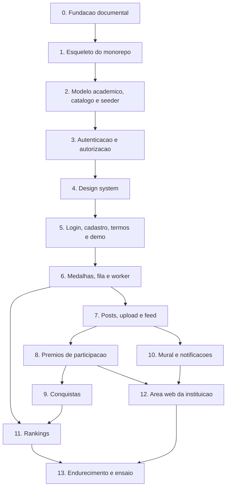

# Plano mestre do Maxx

Treze passos da fase 1, o protocolo de trabalho e a definição de pronto. Regras de
produto em [`produto.md`](produto.md), decisões técnicas em
[`decisoes/`](decisoes/README.md), catálogo em `data/catalogo/`.

---

## 1. Como trabalhamos

1. Antes de cada passo, sai um **plano de etapas** com entrega e critério de aceite por
   etapa.
2. O autor revisa o plano, ajusta se precisar, e só então a primeira etapa começa.
3. Cada etapa termina em **revisão humana do autor** antes do commit.
4. Um commit por etapa. Um PR por passo.
5. Nenhum código antes do plano de etapas aprovado.

Branch: `<tipo>/<assunto-em-kebab>`, com `feat`, `fix`, `docs`, `chore`, `refactor`,
`test`, `ci`. Commit convencional: `<tipo>(<escopo>): <assunto>`, escopos `api`, `mobile`,
`client`, `seed`, `infra`, `docs`, `design`. As branches saem da rodada e voltam para ela
por PR; a rodada vai para a `main` pelo autor.

Padrão de texto em `docs/`: sem travessões. Vírgula, dois pontos ou parênteses.

## 2. Definição de pronto

Um passo está pronto quando:

- testes passando nas camadas que ele tocou: unitário no domínio, integração com Postgres
  real, e2e quando houver fluxo de tela;
- lint e formatação limpos;
- migration criada e aplicada;
- OpenAPI regenerado e o cliente TypeScript sem diferença pendente;
- p95 medido, quando o passo tiver decisão de cache;
- **revisão humana do autor**.

## 3. Duas regras de planejamento

**O esquema cresce por passo.** Cada passo traz a sua migration, em vez de uma migration
grande no passo 2. É mais honesto com TDD e evita modelar no vazio tabelas que só serão
usadas seis passos depois. Consequência: o seed de demonstração também cresce por passo, e
só fica completo no passo 12.

**A ordem segue a dependência de dados, não a de telas.** Em particular, a comprovação de
prêmio de participação é um post com foto, então o post vem antes do prêmio de
participação. Isso inverte a ordem que eu havia proposto antes de escrever o catálogo.

---

## 4. Os treze passos

### Passo 0. Fundação documental

Gravar no repositório tudo que foi decidido, para qualquer sessão futura herdar sem
repetição.

- `docs/produto.md`: regras de produto da fase 1.
- `data/catalogo/`: 46 itens em quatro arquivos, com famílias de trilha.
- `docs/regras-conquista.md`: as duas formas de contagem e o contrato do avaliador.
- `docs/decisoes/`: oito ADRs e o índice de decisões.
- `docs/plano-mestre.md`: este arquivo.
- `CLAUDE.md`: as regras operacionais na raiz.

Sem código executável.

### Passo 1. Esqueleto do monorepo

Ponta a ponta vazio, mas vivo: a web abre, bate na API e recebe 200.

- `Maxx.sln` na raiz; `apps/api` com os quatro projetos; `apps/mobile` com Expo e Expo
  Router; `packages/api-client` gerado; `design/` já existe; `docker-compose.yml`.
- Caddy servindo o build web em `/` e fazendo proxy de `/api`.
- `/health` e `/ready` na API; contêiner de migration separado, com advisory lock.
- Lint e formatação nos dois lados, desde o primeiro commit.
- CI no GitHub Actions com os seis jobs: api, mobile, api-client, e2e, segurança, build.
- `.gitignore`, `.editorconfig`, `.env.example`. Segredo nenhum no repositório.
- Moldura de largura de celular no desktop.
- `docs/fluxos/`: diagramas de sequência de login, post com comprovação, concessão de
  medalha com recálculo de conquistas, contestação e ranking.

### Passo 2. Modelo acadêmico, catálogo e seeder

- Migrations de curso, ano letivo, semestre, bimestre, matéria, turma, vínculo de
  professor, matrícula, cadastro elegível e catálogo.
- Seeder idempotente por comando, com perfis `base` e `demo`, carregando os 46 itens pelo
  código.
- Calendário de 2026 com datas reais de semestre e bimestre.
- Validação do catálogo na CI: faixas de tier, códigos únicos, famílias coerentes,
  referências de `filtroItens` existentes.
- Testes de integração com Postgres real.
- Primeiros testes de domínio em `Maxx.Domain.Tests`, e com eles a remoção do
  `--ignore-exit-code 8` do `.csproj`, posto no passo 1 só porque o projeto nasceu sem
  teste.

### Passo 3. Autenticação e autorização

- Cadastro conferindo RA e e-mail na mesma linha do cadastro elegível; um RA, uma conta.
- Geração e unicidade do arroba, com sufixo por papel e reserva permanente do antigo.
- Login por RA ou e-mail; Argon2id; access token curto; refresh rotativo por família com
  detecção de reuso; logout revogando.
- Papéis e escopo de turma do professor checado no banco.
- Limite de taxa em login, upload e registro de demonstração.
- Flag da demonstração: desligada por padrão, rotas em 404 quando desligada, ausente da
  configuração de produção.
- Recuperação de senha por e-mail.

### Passo 4. Design system

- `tokens.json` tipado, tema claro e escuro, troca de tema.
- Archivo instanciado em largura óptica 112% e embarcado; Instrument Sans.
- Componentes: botão discreto e grande, campo com mostrar senha, controle segmentado,
  chip de filtro, navegação de cinco abas com realce e bolinha de novidade, medalhão com
  tier e raridade, selo de pílula do post, faixa de prêmio, trilha com cadeado, avatar de
  iniciais, estado vazio, estado de erro amigável.
- Grade de 4 px, margem lateral de 16, respiro de 24 antes da navegação.
- Ícones e splash reais do app, no lugar dos PNGs padrão do template Expo que ficaram em
  `apps/mobile/assets` desde o passo 1.

### Passo 5. Login, cadastro, termos e entrada da demonstração

Primeiras telas reais, fechando o ciclo entre autenticação e design.

- Login e cadastro em claro e escuro, conforme as pranchetas.
- Aceite do termo de uso versionado, dentro da identidade visual.
- Entrada da demonstração: botão só com a flag ligada, registro simples, lembrança local
  do dispositivo.
- e2e de cadastro, login, recuperação de senha e entrada de demonstração.

### Passo 6. Medalhas, fila e worker

É aqui que nasce a infraestrutura assíncrona.

- Lista de turmas e alunos do professor; modal de concessão a partir do catálogo.
- Concessão gravando matéria, bimestre, tier e pontos do momento, com limite por período
  e chave de deduplicação respeitados.
- Auditoria de concessão e de anulação.
- Fila na tabela do Postgres e worker consumindo com `SKIP LOCKED`.
- Notificação de medalha recebida, gravada no banco.
- Tela de Troféus com o catálogo, o que falta, o critério e a raridade por escassez,
  recalculada no worker.
- Anulação de medalha pela instituição, por enquanto por comando administrativo.

Fica pendente: a posição no ranking, que chega no passo 11.

### Passo 7. Posts, upload e feed

- Assinatura de upload com tipo e tamanho presos; duas derivadas geradas no cliente;
  limpeza de upload abandonado na fila.
- Post com ao menos um entre prêmio, foto e legenda; um prêmio rende um post.
- Feed por cursor com índice, intercalando seguidos e recomendação com semente de sessão.
- Curtida, comentário, remoção de comentário por autor e por instituição.
- Seguir e deixar de seguir, livre.
- Perfil com grade de três colunas, abas por ícone, pontos e prêmios.
- Busca de alunos por nome de exibição e arroba, com filtros de curso e semestre.
- Editar perfil: foto, nome de exibição e a parte do arroba antes do hífen.
- Deep link `/post/:id` atrás do login.

### Passo 8. Prêmios de participação

- Catálogo de eventos semeado, mais evento em texto livre com nome e período.
- Reivindicação como post com foto, pública com marca de pendente, sem pontuar.
- Fila de comprovações para o professor da turma e para a instituição, ordenada por mais
  antigo, com marca após sete dias, resolvendo a corrida de quem aprova primeiro.
- Reprovação com motivo; nova tentativa é outro post de reivindicação, com outra foto.
- Contestação com motivo, uma por prêmio, estado de averiguação sem pontuar.
- Decisão da instituição: confirmar encerra a janela, revogar mantém no histórico.
- Trabalho na fila que torna o prêmio definitivo após quinze dias.
- `Comprovacao` filtrável por evento, já pensando na aprovação em lote da fase 2.

### Passo 9. Conquistas

- Avaliador das duas formas de contagem, lendo a regra do catálogo.
- Gatilho por fato e por fechamento de período; reavaliação até o congelamento do
  semestre.
- Evidências gravadas por conquista concedida.
- Recálculo na anulação de medalha, removendo conquista que deixou de ser satisfeita.
- Progresso "2 de 3" na tela de Troféus.
- Índice de unicidade por instância de período.
- Um teste por forma, um por item e os testes de fronteira previstos em
  `regras-conquista.md`.

### Passo 10. Mural e notificações

- Aviso nos três escopos; professor seleciona uma ou mais turmas suas.
- Texto com imagem opcional; somente leitura.
- Registro de leitura e bolinha dourada na aba Mural.
- Sininho no cabeçalho do feed, com as notificações de medalha, aprovação, reprovação,
  contestação, decisão e aviso novo.

### Passo 11. Rankings

- Tabela das quatro visões escrita pelo worker, com coalescência.
- Desempate pelo instante da última concessão que compõe a pontuação atual.
- Congelamento do ranking semestral trinta dias após o fim do semestre.
- Entrada pelo toque na própria posição no perfil e pelos atalhos da Busca.
- Filtro entre semestre atual e histórico; topo e linha do próprio aluno em destaque.
- Ex-aluno só no histórico.

### Passo 12. Área web da instituição

- Fila de comprovações e fila de contestações, com aprovar, reprovar, confirmar e
  revogar.
- Conceder prêmio de participação já aprovado.
- Publicar aviso de faculdade e de curso.
- Anular medalha; corrigir e-mail de aluno; marcar ex-aluno.
- Purgar dados de demonstração por lote, em uma transação.
- Seed de demonstração completo: 150 alunos, 120 ativos distribuídos por semestres e 30
  ex-alunos, quatro cursos, turmas, matérias, professores, posts com foto, prêmios
  distribuídos de modo que as quatro raridades apareçam, avisos, eventos passados e
  futuros, duas comprovações pendentes e uma contestação aberta.

### Passo 13. Endurecimento e ensaio

- k6 a 2.000 usuários virtuais, p95 medido em feed, perfil e ranking. Micro-cache da
  primeira página do feed só se o número pedir.
- Verificação de saúde do worker e alerta de fila parada, pelo defeito silencioso
  descrito no ADR 0005.
- CSP, HSTS e cabeçalhos de segurança; varredura de dependências e de segredos na CI.
- Backup: `pg_dump` noturno para o bucket e dump manual antes de migration, com
  restauração testada uma vez.
- APK gerado e fumaça mínima com Maestro.
- Ensaio da apresentação com a banca entrando por rede móvel e o notebook roteado pelo
  celular.
- Purga de ensaio testada, para a purga real do dia seguinte ser rotina.
- Avaliar a troca do Node 22 (em manutenção até abril de 2027) pelo Node 24 LTS no
  `.nvmrc`, no `engines` e na CI.
- Revisar os três achados moderados do `npm audit` no `minimatch`, que chega pelo
  `openapi-typescript` via `@redocly/openapi-core`. Registrados no passo 1: só ferramenta
  de geração, fora do app, abaixo do corte alto ou crítico do job de segurança.

---

## 5. Fase 2

Registrado para não voltar como surpresa: aprovação e concessão em lote por evento,
importação CSV, integração com o sistema de chamada, push nativo, denúncia de post pelo
usuário, posts salvos, sub-papéis de coordenação e secretaria, verificação de e-mail no
cadastro, publicação nas lojas.

## 6. Riscos acompanhados

| Risco | Onde é tratado |
|---|---|
| Rede do campus na apresentação | Passo 13, ensaio por rede móvel. Não há ambiente local alternativo |
| Worker morto congela ranking sem erro em tela | Passo 13, verificação de saúde e alerta |
| Bundle da web grande no primeiro acesso | Passo 13, medição no ensaio com celular real |
| Fila disputando I/O com o feed no pico | Passo 13, primeiro lugar a olhar se o p95 não bater |
| Avaliador de conquista é ponto único de falha lógica | Passo 9, teste por forma, por item e por fronteira |
| Foto pública para quem tem o link | Decisão consciente, ADR 0002, coberta pelo termo de uso no passo 5 |
